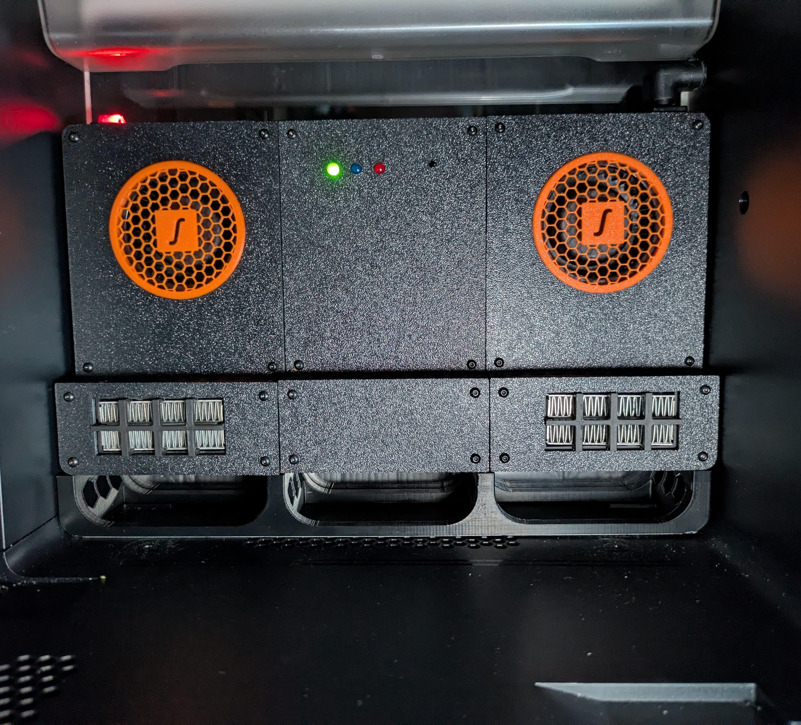
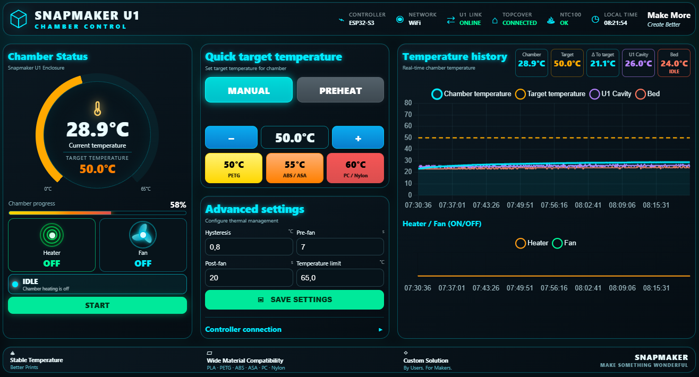
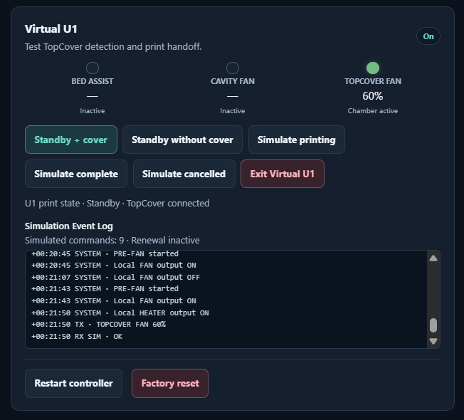

# Snapmaker U1 Chamber

**Active chamber heating for the Snapmaker U1 — a DIY smart controller with Moonraker integration.**

> **230 V mains voltage.** Assembly and electrical work require appropriate qualifications, independent thermal protection and a properly protected installation. [Read the safety requirements](docs/SAFETY.md).

This project combines an ESP32-S3-Zero local thermostat with the U1's built-in functions to help prepare the chamber for printing materials that require elevated temperatures. Estimated build cost according to the developer: approximately USD 33. The developer tested the behavior included in stable v1.0.0 on real hardware.

**[Recommended Chamber Thermal Insulation](docs/THERMAL_INSULATION.md)**. See the optional door seal and Z-axis cover setup, with safety recommendations and prototype photos.

**[Virtual U1](#virtual-u1--advanced-printer-integration-simulator)** exercises Chamber’s Snapmaker U1 integration in detail without a physical connection to the printer.

## Getting Started

1. Review the [safety requirements](docs/SAFETY.md), [BOM](BOM/README.md) and [circuit schematic](docs/schematics/README.md).
2. Use [first installation over USB](docs/INSTALLATION.md#first-usb-installation) to program the ESP32-S3 and its partition table.
3. Use [Wi-Fi OTA](docs/INSTALLATION.md#ota-update) for later application updates on a controller with the matching partition table.

**[Download stable firmware v1.0.1](https://github.com/wlodeka/Snapmaker_U1_Chamber/releases/tag/v1.0.1)**. The owner verified its features and WebGUI on a physical Snapmaker U1 after a Wi-Fi OTA update. [Changelog](CHANGELOG.md)

[See HEATER and FAN active in the Chamber overview](docs/screenshots/web_gui_1_aktiv_fan_heater.png).

## Key features

- Chamber temperature control up to 60°C, with configurable hysteresis and pre-/post-heating fan timing.
- MANUAL and PREHEAT modes with automatic BED ASSIST.
- Automatic TopCover detection and coordinated U1 fan control.
- Automatic handover to the printer when printing starts, and local heating shutdown when an observed print completes or is cancelled.
- Virtual U1 integration simulator with live command indicators, a TX/RX event log and a BED ASSIST renewal countdown.
- Responsive, CDN-independent web interface, diagnostics, charts and OTA updates.

## Operating modes

| Mode | Operation |
|---|---|
| MANUAL | START arms the local thermostat. During active heating, with confirmed U1 idle status and detected TopCover, the controller sets TopCover circulation to 60%. It does not control the bed or cavity_fan. |
| PREHEAT | Selecting this mode requests BED ASSIST: bed at 100°C, cavity_fan at 30%, and TopCover circulation at 60% during active heating when the cover is detected. The local thermostat requires a separate START. Select MANUAL to end BED ASSIST before START. |
| READY | A one-time visual indication and three buzzer pulses when chamber temperature reaches the target minus half the hysteresis. It does not stop heating or assistance, or confirm bed readiness. |

BED ASSIST can renew the bed target every 240 seconds. Every write to U1 requires fresh confirmation of `standby`, `complete` or `cancelled`. Paused, error and unknown states do not authorize writes.

When `printing` is detected, the controller cancels pending commands, returns to MANUAL and sends no zero commands to the bed or fans. An armed local thermostat can continue heating the chamber. When a previously observed print completes or is cancelled, the local thermostat is disarmed.

A manual STOP in PREHEAT can turn off bed heating only after confirmation of the controller's own earlier 100°C command, a fresh idle state and a current target of exactly 100°C. Other targets are preserved. Fan release also requires idle confirmation; circulation commands additionally require TopCover detection.

## Local temperature control

Cycle: IDLE → PRE-FAN → HEATING → POST-FAN → IDLE. The local fan and heater use ON/OFF control. Regulation uses the local NTC, not the U1 temperature sensors.

| Parameter | Default | Range |
|---|---:|---:|
| Target temperature | 30°C | 0–60°C, capped by the limit |
| Hysteresis | 0.8°C | 0.1–10°C |
| Pre-fan | 20 s | 0–600 s |
| Post-fan | 30 s | 0–600 s |
| Temperature limit | 65°C | 1–65°C |

Example: with a 50°C target and 0.8°C hysteresis, a heating cycle starts at or below 49.6°C and heating stops at or above 50.4°C.

## Software safety mechanisms

| Mechanism | Operation |
|---|---|
| FreeRTOS safety task | Dedicated task with a nominal 100 ms cycle, separate from U1 HTTP operations. |
| Watchdog | The pinned Arduino-ESP32 3.3.12 profile provides a 5 s TWDT with panic enabled. Failure to register prevents heating. |
| Infrastructure failure | Task or mutex creation failure, or failure to acquire the lock, forces the relay OFF and local fan ON. |
| NTC validation | Nominal 750 ms sampling; the first invalid reading latches a fault. Valid readings require voltage >20 and <3280 mV, resistance 1 kΩ–1.2 MΩ and finite temperature −15…120°C. |
| Adjustable limit | At the limit, heater OFF and post-fan; reaching a limit below 65°C does not itself latch a fault. |
| OVERTEMP | Fixed 65°C software threshold; latches a fault. |
| THERMAL_RUNAWAY | During continuous active heating at least 5°C below target, a net rise <0.5°C over 600 s triggers a fault. Sufficient rise starts another observation window. |
| Relay protection | At least 10 s after the previous relay switch-off before reactivation. |
| U1 OFFLINE | Invalid snapshot or more than 45 s since the last valid reading; during pre-fan or active heating, disarms the thermostat, turns the heater OFF and starts post-fan. A new START is required after recovery. |
| Latched fault | Heater OFF, local fan continuously ON, buzzer nominally 250 ms ON / 750 ms OFF. |
| Reset fault | Requires valid NTC, temperature below the limit, ONLINE status and relay OFF. Heating remains disarmed; a watchdog infrastructure fault requires correction and restart. |
| Restart / OTA | Local relay OFF acknowledgement required within 500 ms; otherwise the operation is rejected. Also applies to network configuration and factory reset. |
| Startup | MANUAL, thermostat disarmed, outputs set LOW during setup(); last successfully stored fault available in NVS. |

## Important limitations and safety notice

**This device uses 230 V mains voltage. Assembly requires appropriate qualifications, insulation, electrical protection and independent hardware thermal protection.** Software protection is not a substitute for hardware safeguards or certification.

The controller uses a single NTC and does not measure fan RPM, airflow, heater current or actual relay contact position. THERMAL_RUNAWAY is a thermal response test, not a universal detector of all failures.

A local fault, communication loss, restart or power loss does not guarantee U1 bed shutdown. A fault cancels assistance and attempts to release controlled fans, but does not send a zero bed target. HTTP state checks and writes are separate requests; a command already sent cannot be recalled. U1 provides no bed-target ownership identifier, so an identical 100°C target from another source cannot be distinguished. Loss of TopCover detection may leave previous fan settings active.

## Web interface

The dashboard displays local temperature, target, U1 cavity and bed temperatures, heater and fan activity, connection status and faults. Presets: PETG 50°C, ABS/ASA 55°C and PC/Nylon 60°C (not universal material recommendations). A 720-sample RAM buffer at approximately 5 s intervals provides about one hour of history, with 15/30/60-minute views. Temperature and local output activity charts, advanced settings and last-fault diagnostics are included.

The **HEATER** and **FAN** tiles show the ESP32 control outputs. The dashboard reports no independent physical feedback for either load.

## Virtual U1 – Advanced Printer Integration Simulator

Virtual U1 exercises the Chamber integration in detail without a physical connection to a Snapmaker U1. Its scope covers the printer states, TopCover detection and command responses that Chamber uses.

- Select Standby with or without TopCover, Printing, Complete or Cancelled. Use the simulator for first setup, troubleshooting and firmware testing without sending G-code to the real printer.
- The BED ASSIST, CAVITY FAN and TOPCOVER FAN indicators show the last simulated target or speed. A lit LED marks active Chamber control. Starting a simulated print hands control to the print and turns the LEDs off while retaining the last commands for reference.
- The event log separates TX commands, RX SIM replies and controller events. It records BED ASSIST renewal and cancellation. The command counter and countdown help verify the 240-second renewal cycle and handoff.

**The local heater, fan, NTC and buzzer remain active during simulation.** Use a supervised setup with the required electrical and thermal safeguards. Switching between simulated and real U1 discards pending commands and ownership. A real request already in flight can finish. [Simulator operation](docs/OPERATION.md#virtual-u1-diagnostics)

## Configuration and updates

- ESP32-S3-Zero: GPIO 5 — heater relay; GPIO 6 — local fan; GPIO 7 — 100 kΩ B3950 NTC; GPIO 8 — buzzer.
- For initial setup, connect to `U1-Chamber-Setup` (password `chamberu1`), open `192.168.4.1`, and configure Wi-Fi and the printer IPv4 address. Moonraker uses port 7125.
- OTA: configure a password of at least eight characters, use account `chamber` and the correct application `.ino.bin` file. NVS settings are retained.
- The dashboard uses HTTP; ordinary control and configuration routes are unauthenticated. Use only on a trusted local network and do not expose ports to the Internet.

## Firmware and project resources

Download the OTA application and its SHA-256 checksum from [GitHub Releases](https://github.com/wlodeka/Snapmaker_U1_Chamber/releases). See [firmware releases and verification](docs/FIRMWARE_RELEASES.md) for the hardware-tested version, build profile and download instructions.

- [Firmware sketch](firmware/Snapmaker_U1_Chamber/Snapmaker_U1_Chamber.ino)
- [Installation and OTA instructions](docs/INSTALLATION.md), [operation](docs/OPERATION.md) and [safety limits](docs/SAFETY.md)
- [Hardware and GPIO assignments](docs/HARDWARE.md), [schematic in PDF, SVG and PNG](docs/schematics/README.md) and [bill of materials](BOM/README.md)
- [STL print files](docs/mechanical/stl/) and [STEP CAD files](docs/mechanical/step/)
- [Assembly photographs](docs/photos/README.md) and [WebGUI screenshots](docs/screenshots/README.md)
- [Version provenance](docs/PROVENANCE.md)

## Licensing

Original firmware and WebGUI code are licensed under MIT. Original mechanical models, schematics, documentation, photographs and screenshots are licensed under CC BY 4.0. Third-party components retain their own terms. [Project licenses](LICENSE.md) · [Third-party notices](THIRD_PARTY_NOTICES.md)

An independent community project, not affiliated with Snapmaker.
