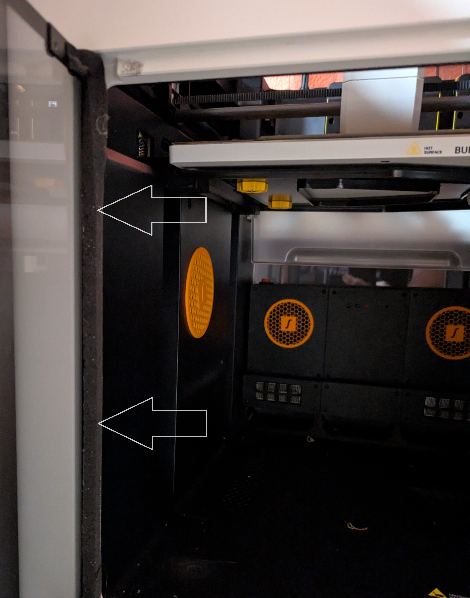
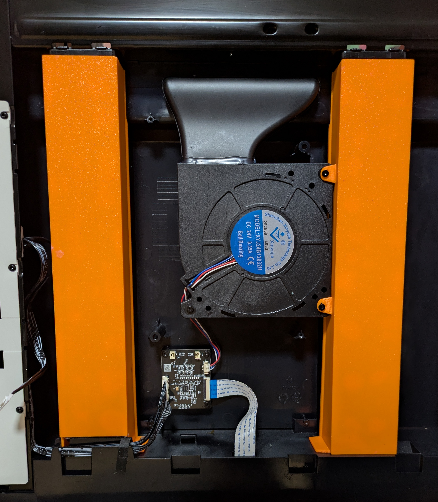
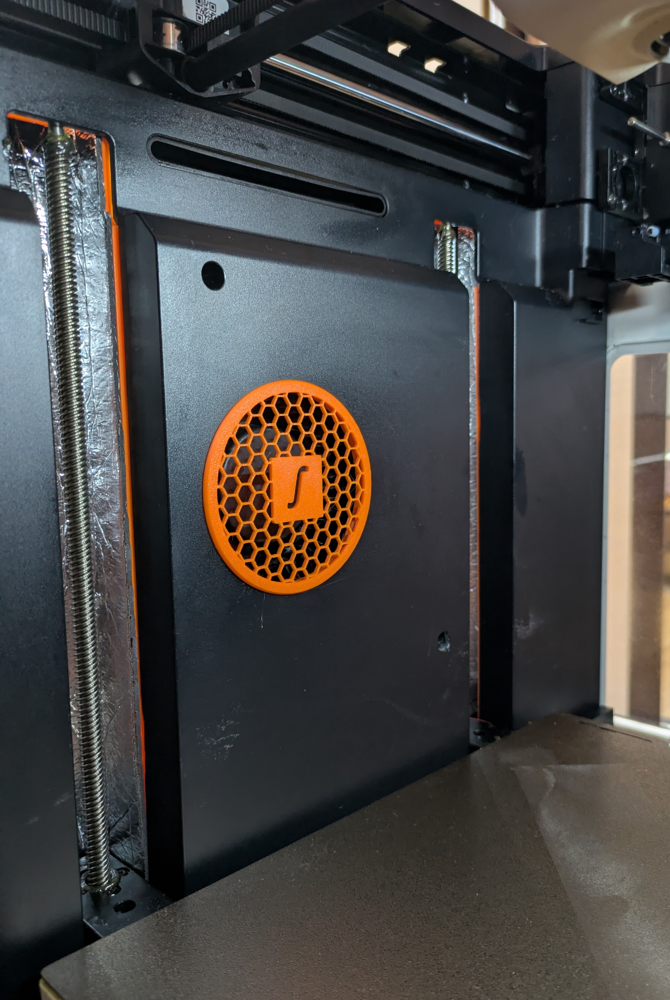
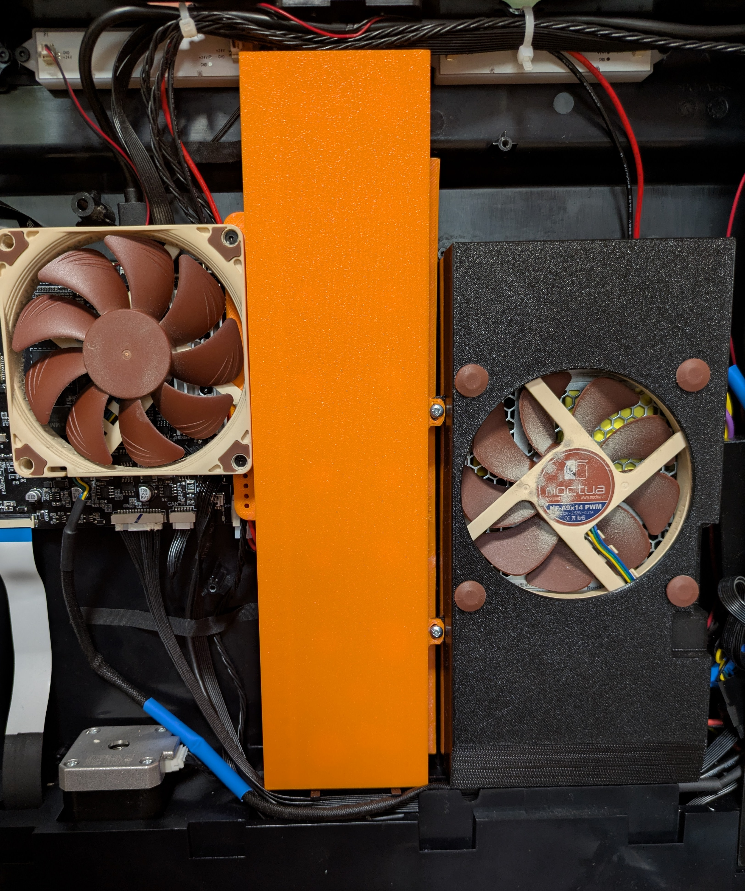
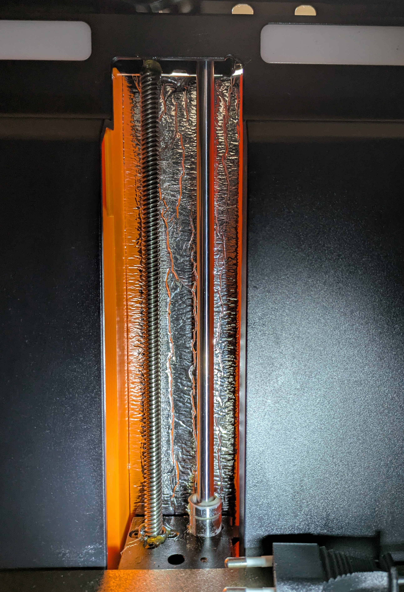

# Recommended Chamber Thermal Insulation

The Snapmaker U1 prototype uses additional insulation at the door and around the Z-axis lead screws. These measures are intended to reduce heat transfer from the chamber into the printer's technical compartments, especially around the power supply (PSU) and main controller board (MCU). They may also improve chamber heating efficiency and temperature stability. The prototype was not evaluated in dedicated comparative tests. Energy savings and the effect on electronics temperatures therefore remain unquantified.

## Insulation measures

- Seal the hinge-side edge of the door with heat-resistant foam sealing tape.
- Fit insulating covers over the openings around the Z-axis lead screw compartments.
- Line the inside of the covers with an additional layer of aluminium foil. Keep the foil secure and clear of moving and electrical parts.

The prototype uses a modified version of a community design. [Original Snapmaker U1 Z-screw cover (insulation mod) on MakerWorld](https://makerworld.com/pl/models/2781235-snapmaker-u1-z-screw-cover-insulation-mod?from=search#profileId-3091021)

## Safety recommendations

- Keep the electronics cooling airflow unobstructed. Leave fan intakes, exhausts and ventilation openings clear, especially around the PSU and main controller board.
- Check that the Z axis can move freely through its full travel. Keep covers, foil and adhesives clear of the lead screws, moving bed and cables.
- Maintain adequate clearance between the conductive aluminium foil and electrical components, terminals and wiring. Secure the foil so it cannot shift into contact.
- Use foam seals, cover materials and adhesives rated for the temperatures they will encounter.
- Thermal insulation is an additional measure. Continue monitoring electronics temperatures and keep independent thermal protection in place.

## Prototype photographs

**Hinge-side door seal.** The arrows point to the foam seal along the vertical edge of the door.

**Left-side Z-axis covers.** Two orange covers flank the cooling duct and fan.

**Left-side foil lining.** Viewed from inside the chamber, the foil is visible behind the Z-axis lead screws.

**Right-side Z-axis cover.** The orange cover is shown alongside the electronics cooling fans.

**Right-side foil lining.** Close-up of the foil lining behind the right-side Z-axis lead screw.

